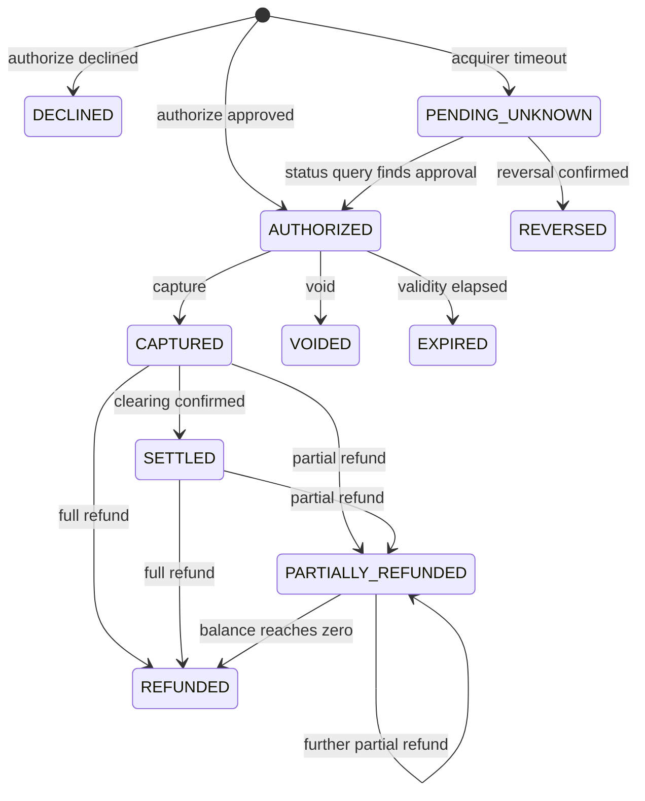
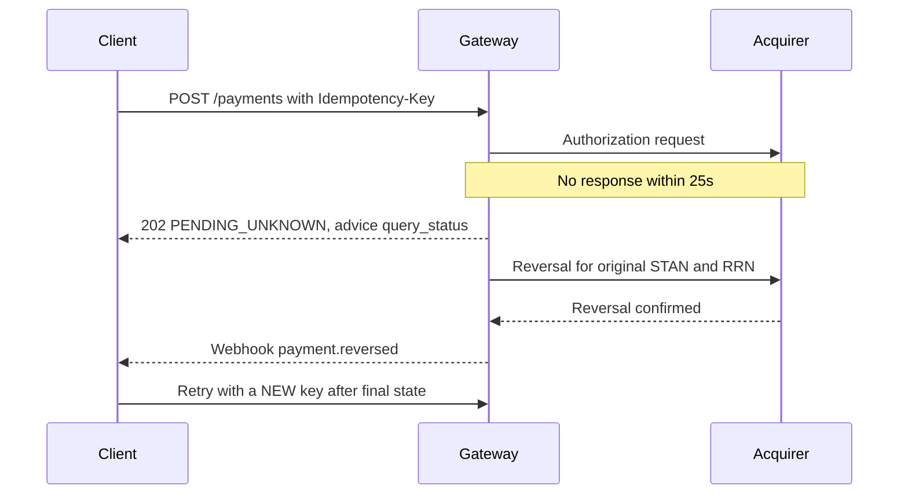
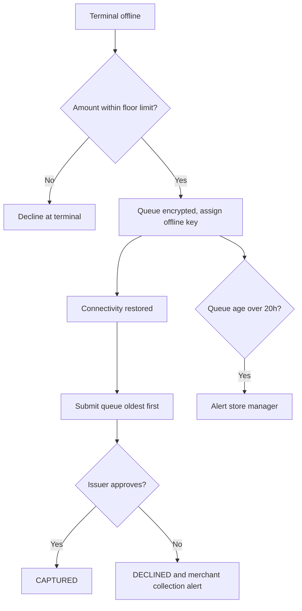

# To-Be Process Design: PayRoute Gateway v2

Extends the [BRD](03-business-requirements-document.md). The approved BRD stays as the baseline; the change requests below record what requirements review found and how each gap is closed.

## 1. Requirements Review Findings

| ID | Finding | Evidence | Resolution |
|----|---------|----------|------------|
| F-01 | `UNKNOWN` outcome exists in a user story but not in the state machine | US-PAY-06 vs BR-PAY-01 | CR-01 adds `PENDING_UNKNOWN` |
| F-02 | Refund is only allowed from `CAPTURED`, yet most refunds happen after settlement | BR-PAY-01 vs US-PAY-04 (180 days) | CR-02 allows refund from `SETTLED` |
| F-03 | 7-day authorization expiry does not fit hotel stays, the use case FR-05 exists for | BR-PAY-01 vs US-PAY-02 | CR-03 makes expiry configurable by MCC |
| F-04 | Idempotency window (24h) equals the offline sync window (24h), so a late terminal retry can fall outside it | BR-PAY-02 vs BR-PAY-03 | CR-04 retains offline keys for 72h |
| F-05 | Partial capture is defined, but single versus multiple captures is not | BR-PAY-01, FR-05 | CR-05 fixes v2 to one capture per authorization |
| F-06 | Generic decline messages are ranked pain point PP-P06, with no requirement behind it | Pain Points vs BRD | CR-06 adds FR-09 |
| F-07 | SCA enforcement appears in the regulatory gap analysis, with no requirement behind it | Pain Points vs BRD | CR-07 adds FR-10 |

## 2. Change Requests

| CR | Rule or Requirement | Statement |
|----|---------------------|-----------|
| CR-01 | BR-PAY-04 | If no acquirer response arrives within 25s, the payment SHALL move to `PENDING_UNKNOWN` and the gateway SHALL send a reversal. A customer-facing outcome SHALL be available within 60s. |
| CR-02 | BR-PAY-05 | Refunds SHALL be accepted from `CAPTURED`, `SETTLED` and `PARTIALLY_REFUNDED`, within 180 days of capture. Cumulative refunds SHALL NOT exceed the captured amount. |
| CR-03 | BR-PAY-06 | Authorization expiry SHALL default to 7 days and be configurable by MCC, up to the validity the scheme allows for that category. |
| CR-04 | BR-PAY-02 (amended) | Idempotency keys generated by offline terminals SHALL be retained for 72h. |
| CR-05 | BR-PAY-07 | One capture per authorization in v2. The uncaptured remainder SHALL be released on capture. |
| CR-06 | FR-09 (Must) | Issuer response codes SHALL map to a merchant reason and a customer-safe message, per [Data and Test Plan](10-data-and-test-plan.md). |
| CR-07 | FR-10 (Must) | For in-scope eCom payments in the EEA, the gateway SHALL apply SCA or record the exemption used, per section 5. |

## 3. Amended State Machine

## 4. Timeout Path

A client retry with the **same** key while the state is `PENDING_UNKNOWN` returns the same `202`, and never creates a second authorization.

## 5. SCA Decision Logic (EEA eCom)

| Order | Condition | Outcome |
|-------|-----------|---------|
| 1 | Merchant-initiated transaction on a stored mandate | Out of scope for SCA, flag recorded |
| 2 | Amount below EUR 30 and issuer cumulative counters allow | Low-value exemption may be requested |
| 3 | Transaction risk analysis passes for the acquirer's fraud band | TRA exemption may be requested |
| 4 | Otherwise | 3DS challenge required |

| TRA amount limit | Reference fraud rate (card payments) |
|------------------|--------------------------------------|
| EUR 100 | 0.13% |
| EUR 250 | 0.06% |
| EUR 500 | 0.01% |

The issuer can always decline an exemption with a soft decline. The gateway SHALL then step up to 3DS once, reusing the same `paymentId`.

## 6. Offline Sync

